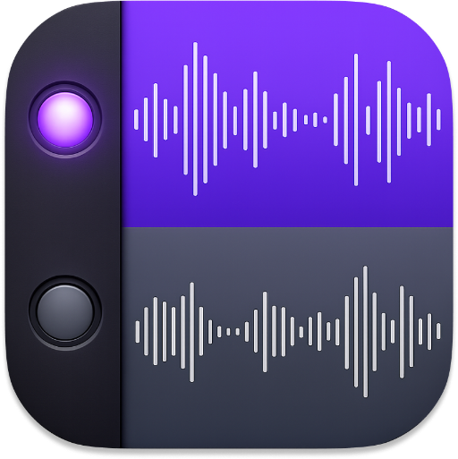
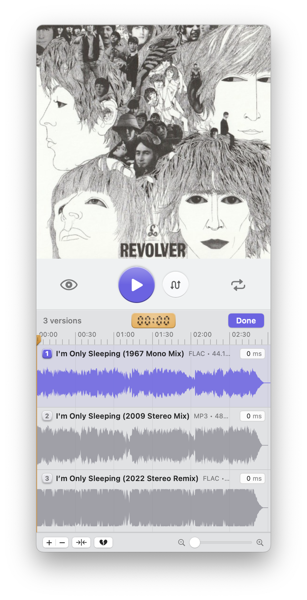

<p align="center">
  
</p>

<h1 align="center">Takes</h1>

<p align="center">
  A beautiful native macOS app for comparing multiple versions of audio tracks.
</p>

<p align="center">
  <a href="https://github.com/Nigelw/Takes/releases/latest/download/Takes.dmg"><strong>Download Latest</strong></a> &middot;
  <a href="https://takes.nigelwarren.com">Visit Website</a>
</p>

<p align="center">
  
</p>

Takes is a macOS audio player that organizes tracks and their versions in a playlist. Open a track in Compare for instant A/B switching, waveform alignment, and blind listening. Mark tracks or versions as rejected to skip them during sequential playback or comparison.

## Build From Source

Requirements:

- macOS
- Xcode with command line tools selected

Open the project:

```bash
open Takes.xcodeproj
```

In Xcode, select the `Takes` scheme, choose `My Mac` as the run destination,
and press `Cmd-R`.

Developer and agent workflow notes live in [AGENTS.md](AGENTS.md). User help
and release notes live on the [Takes website](https://takes.nigelwarren.com).
